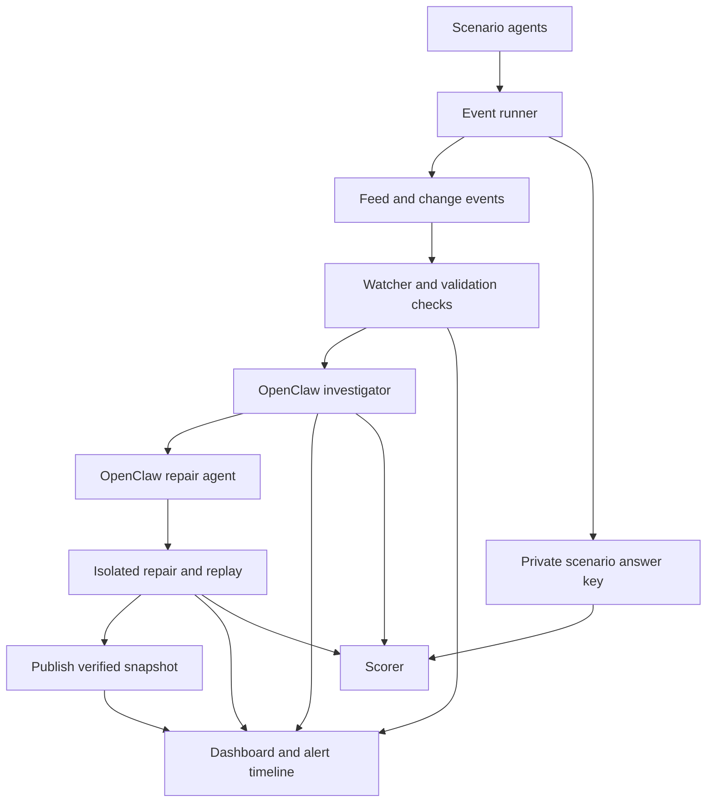

# Schema Guard
## Build specification for Claude Code

Build **Schema Guard**, a local-first application that detects an upcoming breaking data change, prepares a downstream repair, and proves that dashboard numbers stay correct before the change ships. Use **OpenClaw as the agent runtime** and **Kimi K3.1 Pro on Cerebras** for the live agent runs. The reference demo uses synthetic data and runs on Madhu's Mac.

Use **Schema Guard** as the project name in the app UI and README. Use `schema-guard` wherever a repository or package slug is needed.

Implement the full local scope in one pass. Choose the build order, make routine implementation decisions, and run the acceptance tests as part of the same task. Use the existing local Cerebras key and verify it with a live OpenClaw call to Kimi K3.1 Pro. If the live check fails, continue with the fixture-backed implementation and tests and record the exact non-secret error and remaining live verification in the final handoff.

### What the owner already has

- OpenClaw is installed on the Mac. Check the installed version and Gateway status before changing any configuration.
- Madhu confirmed the Cerebras API key is already present on his Mac. Reuse the existing credential and confirm the local OpenClaw Gateway can make a live Kimi K3.1 Pro call. Keep the key out of chat, specs, command arguments, and tracked files.
- Vercel details can be supplied later. Build and verify the local flow now. Keep the UI and long-lived worker separable so deployment is a configuration and persistence change.
- The demo should use multiple agents that produce incoming events and incident variations. Implement distinct scenario-author agents plus separate investigator and repair roles. Make real agent use visible in the dashboard.

### First demo, from start to finish

1. Seed the Orders, Payments, and Shipping team feeds and publish a verified Finance snapshot. Show the snapshot ID, its as-of time, and the revenue total.
2. Click **Run schema-change rehearsal**. Simulate a Payments pull request that changes a dollar-valued field, `payment_amount`, to the integer minor-unit field `amount_cents`. Record the proposed schema, intended effective time, source team and ownership, representative old and new rows, and the producer-declared units.
3. The watcher receives the proposed change before it is active. Compare the candidate contract to the current contract and trace downstream impact. Show **At risk before release** while Finance continues to read its current verified snapshot.
4. The OpenClaw investigator reads the proposal, sample rows, dependency map, relevant job events, and ownership. It returns a structured finding with evidence IDs and the impacted dashboards.
5. The OpenClaw repair agent proposes a typed change to the downstream mapping. A repair worker applies the change to an isolated branch or temporary Git worktree. Show the diff and validation results.
6. Replay the baseline and repaired candidate against equivalent records. Compare per-payment normalized rows, aggregates, and joins. Apply the new contract and mapping in the **local simulation** only after the checks pass. The next normal refresh publishes a new snapshot and the revenue total remains correct.
7. Show alert time, diagnosis time, time to verified repair, the eventual publish status, and who owns the impacted feed. A failing repair leaves the current snapshot active and surfaces the first failed check.

Replay uses a fixed starting clock and sample records so both success and failure are reproducible. An actual GitHub webhook is an optional later integration. The local demo must exercise the same event and processing path through a synthetic producer event.

## 1. Architecture



**Next.js dashboard and API.** Use a TypeScript Next.js App Router project. The browser starts rehearsals, reads results, and shows evidence and timings. The API accepts a validated request, persists a job or event, and returns promptly with an ID.

**Local worker.** Run a separate Node process on the same machine as OpenClaw. It owns event processing, scheduled feed checks, OpenClaw invocation, sandboxed worktree management, and publishing. Expose health and last heartbeat through persisted state. Use Node subprocess spawning with argument arrays and bounded output for CLI integration. For the first implementation use one worker and serialize runs that share a fixture. Allow scenario authors to generate variations concurrently.

**Persistence.** Use local Postgres via Docker Compose with migrations and synthetic fixtures. This is a deliberate choice to keep the queue and state compatible with a later managed Postgres instance, such as Supabase. Store demo feed rows and snapshots in Postgres too. Use integer minor units in the canonical model and integer/decimal-safe comparisons, including in JavaScript. Store monetary output as integer cents or a decimal string at the API boundary.

**Agent runtime.** OpenClaw manages role workspaces, sessions, and model calls. Kimi on Cerebras interprets evidence, proposes repairs, and authors scenarios. Application code owns typed event validation, applying supported actions, testing, and publishing. Keep all operational connections and provider secrets on their respective servers.

## 2. Set up OpenClaw and Cerebras on the Mac

1. Record the installed OpenClaw version, inspect `openclaw gateway status` and `openclaw agents list`, and check the local CLI help for agent and provider flags. Reuse the working installation. Keep the gateway bound locally. Put project-specific roles in dedicated workspaces so personal agents and sessions can continue to be used.
2. Check whether the official Cerebras provider is installed. The commands below are for inspection and recovery. Install the provider only if it is absent. Run onboarding only if the Gateway cannot use the existing credential and the installed provider requires onboarding. Check the installed CLI help and read the provider docs if the installed version differs. Onboarding can select its own default model, so verify and preserve the previous personal defaults as needed.
   
   ```bash
   openclaw plugins install @openclaw/cerebras-provider
   openclaw onboard --auth-choice cerebras-api-key
   openclaw models list --provider cerebras
   openclaw gateway status
   ```
   
3. Check whether the Gateway can use the existing Cerebras credential through its provider auth or local service environment. A macOS background service might not inherit a terminal export. If the CLI can see the provider but the Gateway cannot, diagnose the service environment using status and service controls without printing credential values. Preserve the existing setup when the live call succeeds. Leave the key out of browser variables, Vercel frontend configuration, logs, and agent prompts.
4. Resolve the exact Cerebras API model ID from the account's model metadata or access instructions. Configure each project role to use the corresponding `cerebras/<model-id>` reference. Treat a successful Kimi completion under the authenticated account as the evidence of access. Public discovery can omit preview models or list models without confirming entitlement. If discovery omits the model, use the provider’s supported explicit model configuration with the confirmed model ID and metadata. Avoid copying a model slug from Moonshot's own API into Cerebras configuration without verification.
5. Run a minimal OpenClaw completion, then an evidence-reading or evidence-packet turn through the same adapter the worker uses. Capture provider, model, elapsed time, and error category in diagnostics. Verify the actual run used Cerebras and the chosen Kimi model. Surface unauthorized, unavailable, rate-limited, timeout, and malformed-output states separately. For model comparisons, select a separate explicit run configuration and label the result.
6. Create the named agent workspaces from checked-in templates. Use a unique session for each run and role. With the Gateway route, use the installed CLI's `openclaw agent --agent ... --json` capabilities and unique session keys where supported. Explore its documented structured CLI output with a smoke run before writing the parser. Prefer prompt input via stdin or a private temp file where supported. If the installed CLI lacks the required option, use the locally documented Gateway interface, or the documented headless agent entry point with equivalent role configuration. Keep this choice inside one adapter. Avoid `--deliver` for application turns.

Provide a fixture-backed adapter for repeatable tests and provider outages. Clearly label those runs **Fixture mode**. A live run through OpenClaw on Cerebras is a separate acceptance check.

## 3. Data, lineage, and events

Start with a small repository fixture and a few dozen records. Use one currency for the acceptance demo. Add refunds, nulls, and multiple currencies as explicit tested cases. Include an independent expected-output fixture for each baseline.

| Object | Minimum contents |
|---|---|
| Source contract | Source/team ID, version, field name, type, required/nullability, semantic meaning, unit, currency policy, keys, expected delivery schedule and owner |
| Synthetic data | Equivalent Orders, Payments and Shipping fixtures under the baseline contract and each supported candidate contract |
| Lineage | From/to dataset or dashboard, affected column where known, owning team and transformation reference |
| Event envelope | Event ID, version, type, source, event time, received time, scenario run ID, deduplication key and schema-validated payload |
| Run and job | Status, attempt, next available time, claim token and lease expiry, timeline, provider/model, output and timing metadata |
| Finding and repair | Severity, observed symptom, cause status, evidence pointers, affected assets, owner, proposed typed change, diff, replay result |
| Snapshot and publication | Revision, data-as-of time, input/contract versions, exact totals, validation result and current snapshot pointer |
| Scenario expectation | Run ID, injected change, expected cause, expected impact, expected outcome and optional timing expectation. Scorer-only access |

Minimum event types are `source.change.proposed`, `source.export.started`, `source.export.progress`, `source.batch.arrived`, `pipeline.check.failed`, `pipeline.validation.completed`, and `snapshot.published`. Include fixture generation for a future-deadline warning. Log events and results with correlation IDs. Store UTC and display local time where appropriate.

Build the lineage fixture as:

- Orders feed → staging orders → order facts → Revenue and Operations dashboards.
- Payments feed → staging payments → order facts and payment facts → Finance and Revenue dashboards.
- Shipping feed → staging shipments → fulfillment facts → Operations dashboard.
- Make join edges and the grain explicit. A single order can have multiple payment and shipment records. Preaggregate where required and test that downstream joins preserve totals.

For schema drift, compare field types, presence, nullability, units and keys before running the candidate. A missing file emits no log. Use expected schedule and expected progress times to emit a risk event if a deliverable is likely to miss its deadline. Start with an explicit rule such as “export has yet to start by the warning time” and a configurable grace interval. Describe it as a warning and update it when progress arrives.

## 4. Multiple agents and their contracts

Create individual OpenClaw agent definitions or role workspaces. Scenario agents should actually return incident and event plans. Run them on demand in a small bounded pool, validate and persist the output, then let the application runner emit each accepted plan's events against the fixtures. The owner should be able to click **Generate scenarios** or **Replay selected scenario** and see the author, scenario seed, accepted plans, and invalid plans with reasons.

| Agent | Input | Required output and scope |
|---|---|---|
| Orders scenario author | Orders contract, supported event types and baseline fixture | A scenario plan covering schema, delivery, volume, or join changes |
| Payments scenario author | Payments contract, supported types, currency and key rules | A scenario plan covering field, unit, duplicate, or refund changes |
| Shipping scenario author | Shipping contract, allowed operations and deadline rules | A scenario plan covering late delivery, evolving fields, or cardinality |
| Investigator | Alert or proposed-change event, evidence access, safe lineage view | Structured impact analysis with affected assets, owner, candidate cause and evidence IDs |
| Repair agent | Approved finding, mapping rules, fixture scope and repair capabilities | A typed repair suggestion with assumptions and expected invariants, or a request for a missing contract fact |

Scenario plan fields should cover `scenario_id`, `team`, `seed`, `starting_snapshot`, `events` with time offsets and typed payloads, `fixture_mutation`, and `expected_outcome`. Persist expectations separately before enqueueing. The runner only accepts declared mutation types and validated parameters. Event payloads contain observable facts. The investigator's evidence view excludes scorer records and scenario-author session histories. Suppress accidental answer leaks in alert titles, fixture names, logs, or IDs used in a blind run.

Give the investigator read-only access to candidate contracts and sample metadata, downstream lineage, and job or feed events by run and time. Implement scoped OpenClaw tools if the installed runtime supports a straightforward local extension. A bounded evidence packet assembled by the worker is a supported first implementation. Keep the provenance IDs stable across either approach.

The investigator returns observed facts, a cause status of `confirmed`, `likely`, or `unknown`, evidence IDs, impacted assets, owner, and the next verification step if needed. Validate those IDs against evidence actually available for the run. The repair role can propose a declared operation such as `rename_field`, `convert_minor_units`, or `update_field_mapping`. Require an explicit contract assertion for units, keys, and semantics. If the evidence only suggests a mapping, show what the owning team needs to confirm.

### Twenty-case catalog

Ship deterministic seed scenarios for regression and have the author agents generate additional replayable variants. The first three built cases should be the compound rename and unit change, a safe additive change, and a missing or ambiguous unit contract. For the complete catalog use:

1. Payment field renamed and dollars changed to cents, explicitly declared.
2. Safe nullable Orders field added.
3. Payment unit changed or renamed with ambiguous contract metadata.
4. Required order ID removed.
5. A nullable field becomes required with existing nulls.
6. Numeric payments silently become strings.
7. Refund sign convention changes.
8. Currency field removed from a multicurrency sample.
9. Duplicate payment IDs arrive in one batch.
10. An already-applied batch is delivered again.
11. An old batch arrives after a newer batch.
12. Payment rows are missing but the file is present.
13. Orders volume falls outside a configured range.
14. Shipping export misses its expected progress time and arrives before cutoff.
15. Shipping export misses its hard deadline.
16. A warehouse transformation fails after valid input.
17. A downstream join changes from one-to-one to one-to-many.
18. The upstream change is reverted after the warning.
19. Two independent changes arrive in close succession and remain properly correlated.
20. OpenClaw or Cerebras is unavailable while a candidate still needs deterministic validation.

Persist the actual scenario plan and if relevant the exact fixture mutation. Test plans with fixed seeds and use a simulated clock to fast-forward waits. Allow the generator to rerun when an output is invalid and keep the original failure in the run history. Start with concurrency three for scenario authors and one active rehearsal per fixture. Increase investigations across independently isolated fixtures after checking real provider limits.

## 5. Proactive checks, repair, and publication

### Trigger before the existing refresh

The primary trigger is a candidate contract or pull request event. The worker compares proposed and current schemas as soon as the change appears. Compute affected datasets and dashboard IDs from lineage. A safe additive change can pass quickly. A semantic change or downstream break opens a rehearsal and an investigation. Keep timed source progress checks as a second proactive trigger. When a source has no preview or progress signal, staging validation at arrival is the earliest available check.

### Apply and test an actual downstream repair

Generate a repair in the local fixture repository and create a run-specific Git worktree from a known baseline. The repair agent returns a schema-validated mapping operation. The worker applies it, generates a Git diff, and runs the repository's real transformations and tests. Restrict the worker to the fixture files and known operations. Use a versioned mapping file where practical. Capture baseline revision and candidate revision. Avoid changes to Madhu's existing repositories and local working trees.

Reconcile original and candidate results on the same logical records. For the primary case, `12.34` USD and `1234` cents must both normalize to `1234` cents. Compare per-record keys and canonical amounts, row counts, duplicate IDs, rejected rows, required foreign key relationships, per-currency totals, and dashboard totals. Include a negative control where a mapping omits the conversion and the replay fails. Equal aggregate totals alone can hide incorrect individual rows. Verify downstream joins at the correct grain.

A passing rehearsal yields a tested repair and diff. The synthetic app can apply the allowed change and publish automatically within its own fixture environment. For a real cross-repo migration, route the upstream and downstream changes through their existing CI, branch, and release rules. A compatibility window or coordinated activation can support both contract versions where upstream and downstream release separately.

### Publish complete snapshots

Stage a candidate snapshot. On successful deterministic checks, update the current pointer in the same database transaction that records successful publication. Use input version checks and an expected previous revision so a delayed or duplicated event cannot overwrite a newer snapshot. If a check fails, keep the prior verified snapshot visible and show its actual as-of time with an **At risk** or **Delayed** label. Show **At risk** during the proactive rehearsal without implying that current numbers are stale. An agent timeout still leaves publication controlled by deterministic validation rules.

## 6. Dashboard and notifications

- Show three source teams, current published Finance total, data-as-of time and snapshot revision.
- Add **Run schema-change rehearsal**, **Generate scenarios**, and a scenario picker. Keep the first run discoverable as a single action.
- Show a timeline from proposed change through affected dashboards, investigator evidence, repair diff, replay, and eventual publish. Include actor, time and evidence IDs. Render one expandable input/output excerpt with secrets redacted.
- Make the distinction between current health and future change risk clear. The first screen should explain what would break, which owner is involved, and whether the change has a verified fix.
- Log an in-app alert with fields for cause/status, affected dashboards, ownership, current data freshness, evidence and next action. Update the same incident as the diagnosis or repair changes. External messaging can use an explicit destination later.
- Provide a simple UI refresh strategy, such as bounded polling for an active run, for both local and hosted use.

## 7. Queue, failures, and evals

Use a durable jobs table and claim jobs transactionally, with `FOR UPDATE SKIP LOCKED` when multiple workers are allowed. Set claim/lease deadlines and heartbeat during long jobs. Check the lease token when committing results. Requeue abandoned work and deduplicate by event and logical operation. Use bounded retries with backoff for transient errors and persist an actionable error for invalid input or configuration. Record the last known worker heartbeat and give the local UI an understandable offline state.

A small deterministic scorer should compare predicted cause/status, affected dashboards, test evidence, and publish outcome against saved expectations. Require cited evidence for a diagnosis counted as verified. Show time from proposed-change event to first verified finding and time to passing repair, plus queue, model, tool, and replay time. Record wall-clock time for concurrent work without adding overlapping intervals as if they were sequential. Report actual observations and label fixture mode. A fair inference speed comparison uses the same scenarios, agent prompts, tools, and Kimi model, changing only the provider where the same model is available. Otherwise label the comparison as system-level.

## 8. Local runbook and acceptance tests

Provide `.env.example` with placeholders for `DATABASE_URL`, `AGENT_MODE`, `OPENCLAW_BIN`, the resolved project role model reference or role IDs as needed, and worker limits. Use the existing Cerebras credential through OpenClaw on the worker host. Add package scripts with clear docs. Suggested names follow; implement and document the actual commands.

```bash
npm ci
docker compose up -d db
npm run db:migrate
npm run db:seed
npm run dev
npm run worker
npm test
npm run build
```

Acceptance tests should cover a good baseline, a blocked bad mapping, a verified repair, an allowed additive change, visible ambiguity, detection of late or absent files, duplicate and out-of-order events, lease expiry and restart, rejection of wrong-run evidence, malformed agent output, replay failure with the previous snapshot retained, provider outage, model run provenance, and visible fixture labels. Document the commands and results Claude actually ran. Record the live acceptance result and any specific access or runtime error.

## 9. Vercel and remote OpenClaw

### Recommended now

Run the dashboard, database, worker, and OpenClaw on the Mac. The worker can reach the Gateway at its local loopback address. Kimi inference takes place on Cerebras after OpenClaw sends the model request. This proves the end-to-end flow before cloud credentials, auth, DNS, or deployment enter the picture.

### Later, Vercel dashboard with OpenClaw on the Mac

- Deploy the Next.js dashboard and short API handlers on Vercel. Use a hosted Postgres database, such as a Supabase Postgres project, for shared state and jobs. The UI reads progress and the API authenticates requests, enqueues work and returns a job ID.
- Run a worker on the Mac. It makes outbound connections to the hosted database or authenticated queue API, claims jobs, invokes local OpenClaw, and writes results and heartbeat.
- The Mac Gateway can remain on loopback. Inside a Vercel function, `localhost` refers to that function's own environment. Vercel functions have a bounded execution lifetime, and local function scratch space is ephemeral. The agent runtime and continuous watcher live with the worker.
- While the Mac or worker is offline, the hosted UI can show previous results and queue new work. Jobs resume when the worker reconnects. Surface the offline heartbeat so an old result is distinguishable from an active investigation.
- Put Vercel database credentials and app auth on the server. Keep the Cerebras key and OpenClaw credentials on the worker host. Use scoped worker credentials and avoid exposing the Gateway or development filesystem publicly. Protect a hosted dashboard before connecting it to real company data.

### Always-on option

Install OpenClaw and the worker on a small VM or another always-on host, configure Cerebras there, and run both processes under the host's service manager. Clone or sync the project workspace and give the VM its own database access and credentials. The Vercel frontend and queue design stay the same. OpenClaw tools and worktrees operate on the host where they are configured. A VM Gateway can work with separately connected nodes for selected device capabilities if needed. For this app, keep the repository fixtures and data tools on the worker host. For administration, use the documented private remote-access route, such as SSH forwarding, if needed.

When Madhu is ready to deploy, collect Vercel project details, hosted database connection details, sign-in needs, and choice of worker host through their normal setup flows. The local build can finish before any of those choices.

## 10. Official references for implementation

Check the installed version and use the relevant current documentation when command flags differ. The build specification uses these sources for the runtime and hosting assumptions.

- [OpenClaw Cerebras provider](https://docs.openclaw.ai/providers/cerebras)
- [OpenClaw agent CLI](https://docs.openclaw.ai/cli/agent)
- [OpenClaw named agents](https://docs.openclaw.ai/cli/agents)
- [OpenClaw sub-agents](https://docs.openclaw.ai/subagents)
- [OpenClaw Gateway remote access](https://docs.openclaw.ai/gateway/remote)
- [Vercel function duration](https://vercel.com/docs/functions/configuring-functions/duration)
- [Vercel function runtimes and filesystem](https://vercel.com/docs/functions/runtimes)

### Claude's final handoff

Provide the working local repository, setup commands, the three quickest replay cases, a sample diagnosis and repair diff, tests actually run, current fixture versus live status, and specific inputs still needed from Madhu. Make the first success path one run that proves a future upstream change was detected, repaired, and verified before it could change dashboard numbers.
